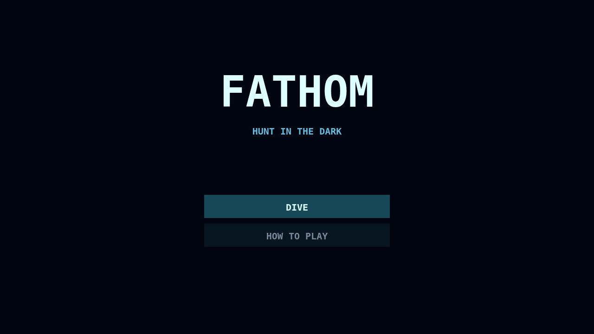

# Hunt in the dark

Fathom drops you into a trench where the maze exists only as far as your light can reach. Graze each corridor clean and every bite of plankton brightens your body, widening the circular window onto ground you have already discovered.

Send sonar through junctions to remember the route ahead, but listen for what answers. Lanternjaw follows your glow while masquerading as an innocent amber drifter, Gloamfin hunts the sound of your pulses, and Flarefish turns the whole abyss visible for one dangerous instant.

Ink can break a hunter's sightline, but darkness is never safety by itself. Clear the final mote to descend, carrying your score and remaining lives into a tighter, more crowded hunt.

